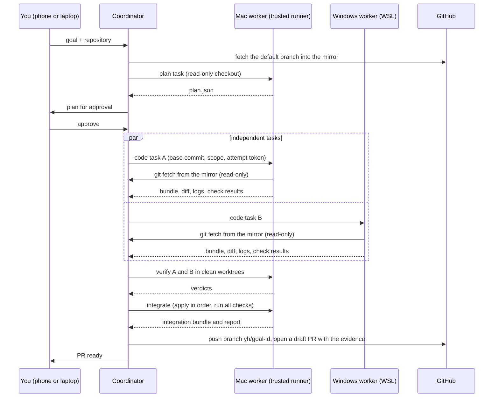
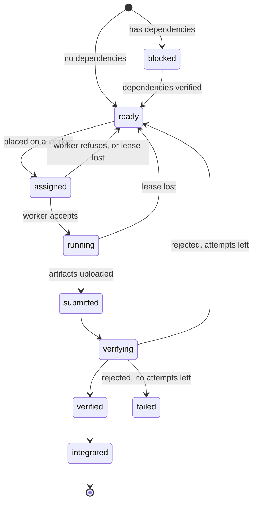

# Agent workers: plan, workflow and tests

**Status:** plan only, November 2026. Nothing in this document is built yet.
**Based on:** `main` at `a9cd08e` (v0.7.2) and *YourHarness — Product Vision & Technical Blueprint* (cited below as "vision §N").

---

## 0. What we're building

Any computer in the pool can take an **agent task**: work done by an AI agent CLI (Claude Code, Codex CLI, Kiro CLI) in a workspace of its own on that computer. Each task has a defined output and a check that the output is right.

Coding is the first kind of task. Its output is a range of Git commits; a trusted runner verifies them and YourHarness turns them into a pull request. The same machinery later runs other kinds of work: research and writing, file processing, test shards and reviews.

The first complete loop: from the phone or a laptop, give one goal for one GitHub repository. The pool plans it as tasks and runs them in parallel on the Mac and on the Windows PC (inside WSL). It verifies each result, combines the results and opens one draft pull request. Nothing is merged without you.

## 1. Scope

**In this plan (the MVP):**

- Owned computers only: computers that joined with the owner link and have agent tasks switched on.
- Task kinds `check` (commands, no AI), `code`, `plan` and `integrate`, then `general`.
- Adapters: a scripted test adapter, then Claude Code, Codex CLI and Kiro CLI.
- GitHub repositories, with one fine-grained token held by the coordinator.
- Command line, dashboard and phone views for goals, tasks, changes and approvals.

**Later, in separate plans:**

- Lenders running agent tasks. This needs VM-level isolation (vision §9).
- GitHub App sign-in, plus other Git hosts.
- Direct computer-to-computer transfers, and models split across machines.
- Auto-merge. YourHarness never merges and pushes only to branches named `yh/…`.

## 2. Terms

| Term | Meaning |
|---|---|
| Goal | What you ask for: text, a repository (for coding) and limits. It becomes a plan of tasks. |
| Task | One unit of work for one computer: its kind, instructions, inputs, file scope, checks, budget and dependencies. |
| Attempt | One run of a task on one computer. Retries and reassignments create new attempts. The attempt number lets the coordinator refuse late results. |
| Round | Inside one attempt, one more pass by the agent after its checks failed, with the failure output added to its prompt. |
| Worker | An owned computer with agent tasks switched on. It runs `task_slots` tasks at once (default 1). |
| Adapter | Code that drives one agent CLI without a person at the keyboard and reads its progress. |
| Workspace | The task's own folder: a Git worktree for `code`, a scratch folder for other kinds. |
| Artifact | A file a task returns (bundle, diff, logs, report), stored on the coordinator under its SHA-256. |
| Verification | A trusted re-check of a task's result in a clean workspace. |
| Integration | Combining verified results on one branch, testing that branch and opening the PR. |
| Lease | The coordinator's promise that an attempt belongs to one worker until a deadline. Heartbeats renew it. |
| Trusted runner | The worker that verifies and integrates. By default it's the coordinator's own computer. |

## 3. Workflow

### 3.1 What you do

1. **Once per repository.** On the coordinator, run `harness repo add Dibae101/<repo>` with a fine-grained GitHub token for that repository only, with *Contents* and *Pull requests* set to read and write. The token never leaves the coordinator.
2. **Once per computer.** Switch on "Agent tasks" (a switch in the app, or `harness agent --tasks`). Sign in to the agent CLI on that computer; on Windows, sign in inside Ubuntu (WSL).
3. **Give a goal** from the dashboard, the phone or the command line, for example `harness goal "Add a dark mode toggle with tests" --repo Dibae101/<repo>`.
4. **Review the plan.** It shows the tasks, which computer each will run on, which files each may touch, the checks and the budget. Edit it or approve it.
5. **Watch the run.** Each task shows a live log tail, its current phase, and the time and cost used so far. You can cancel or retry any task.
6. **Open the pull request.** It lists every task with the computer that ran it, the checks and their results, the time and the cost. You merge it on GitHub yourself.

### 3.2 What the system does



**A worker running one `code` attempt:**

1. Accepts the assignment and records it in a local state file, so a restart knows about it.
2. Fetches the base commit into its repository cache from the coordinator (read-only, using the attempt token).
3. Creates a worktree at the base commit in `~/.yourharness/tasks/<task>/<attempt>`.
4. Runs the setup commands from `.yourharness.toml` or the task.
5. Runs the agent with the task prompt inside the time and cost limits, streaming progress.
6. Runs the checks. If they fail and rounds remain, runs the agent again with the failure output.
7. Commits all changes to a local branch `yh/<task>-<attempt>`, then writes `result.bundle` (`base..branch`) and `result.diff`.
8. Uploads the artifacts over HTTP, then sends `task.done`.
9. Removes the worktree. Worktrees of failed attempts are kept for one day for debugging.

**The coordinator:**

1. Imports the bundle into the mirror as `refs/yh/tasks/<task>/<attempt>`.
2. Has the trusted runner verify it in a clean worktree (§4.7).
3. Once every task of the goal is verified, has the trusted runner integrate them in dependency order and run the full checks.
4. Pushes `yh/<goal>` and opens a draft PR.

### 3.3 States

**Goal:** `planning → awaiting_approval → running → integrating → pr_open → done`. A goal can become `failed` or `cancelled` from any state. `done` means the PR was merged or closed, as read from GitHub. The MVP may stop at `pr_open`.

**Task:**



Any state can move to `cancelled`.

**Rules:**

- Results count only while their attempt's lease is current and the attempt number matches.
- A failure that is the agent's fault uses an attempt: checks still failing after the last round, a verification rejection, or a conflict that persists after a rebase.
- A failure that is the computer's fault moves the task to another computer without using an attempt, at most 3 times. This covers a disconnect, a rate limit, or a CLI that isn't signed in.

## 4. Architecture

### 4.1 Components

**Coordinator**, in a new package `yourharness/coordinator/tasks/`:

| Module | Does | Plugs into |
|---|---|---|
| `db.py` | SQLite in WAL mode at `data_dir/tasks.db`. Holds goals, tasks, attempts, artifacts, events and approvals. The schema version lives in `PRAGMA user_version`, with a list of migrations. | `Store`'s data folder |
| `model.py` | Goal and task records, and the state machine as pure functions. | nothing; easy to unit test |
| `manager.py` | `TaskManager`: places ready tasks, handles leases, refuses stale attempts, reconciles reconnects, runs goals, broadcasts `task.*` events. | `Scheduler.__init__`, next to `Execs` and `PoolStore`; `connect`, `disconnect` and `handle` |
| `placement.py` | Decides which workers are eligible and ranks them (§4.9). | device views from `Scheduler` |
| `tokens.py` | Per-attempt tokens: stored hashed, scoped to one attempt, expire when it ends. | `Coordinator.authed` |
| `artifacts.py` | Content-addressed files in `data_dir/artifacts/`. Uploads are streamed, hashed and size-limited; files nothing refers to are cleaned up. | new HTTP routes |
| `git_mirror.py` | One mirror per repository: fetch from GitHub or a local path, serve read-only smart HTTP through `git http-backend`, import bundles, make diffs. | a new `/git/` route |
| `github.py` | Pushes the integration branch, then creates or updates the PR through the REST API (aiohttp). | `secrets.py` |
| `secrets.py` | `data_dir/secrets.json`, file mode 0600. Never sent to a device, never logged. | |
| `kinds/` | One module per task kind: validate the spec, build the prompt, define the output, apply the verification rules. | |
| `api.py` | HTTP routes for repositories, goals, tasks, artifacts and events (§4.3). | `Coordinator.build` |

`Device` reads a new `tasks` field from `hello` only for trusted agents, the same way it already ignores a lender's `exec` claim.

**Worker**, in `yourharness/agent/`:

| Module | Does | Plugs into |
|---|---|---|
| `tasks.py` | `TaskHost`: slots, assignments, the attempt lifecycle and a local state file. Keeps attempts running through short disconnects and reports them on reconnect. | `Agent._handle`, `Agent._hello`. The cleanup in `_connect_once` must not kill tasks the way it kills pool shell commands today. |
| `workspace.py` | Bare repository cache, worktrees, scratch folders, cleanup and disk-space checks. | |
| `adapters/` | `base.py`, `scripted.py`, `claude.py`, `codex.py`, `kiro.py` (§4.8). | `tasks.py` |
| `inventory.py` | Finds git, node, npm, python, docker and the agent CLIs, with their versions. On Windows it checks inside WSL. | `_hello` |
| `procs.py` | Process helpers moved out of `runner.py`: killing a process group, wrapping commands for WSL, streaming output, building a minimal environment. | `runner.py`, `tasks.py` |

**Shared:** `client.py` gains goal and task methods. `cli.py` gains `repo`, `goal`, `goals`, `task`, `tasks` and `approve`. `web/app.js` gains Goals, Tasks and Changes views.

### 4.2 Task kinds

| Kind | Workspace | AI agent | Output | Verification | Result goes to |
|---|---|---|---|---|---|
| `check` | worktree or scratch folder | no | logs, exit codes, files in `out/` | exit codes | the goal record |
| `code` | worktree at the base commit | yes | bundle (`base..branch`), diff, logs, check results | trusted re-check (§4.7) | the integration branch |
| `plan` | worktree, changes discarded | yes, read-only mode | `plan.json` | schema, task graph, scopes, budgets | your approval |
| `integrate` | worktree at the base commit | no | integration bundle, full check report | exit codes | the GitHub PR |
| `general` (Phase 7) | scratch folder with `inputs/` and `out/` | yes | files in `out/`, `report.md` | file manifest, optional check command, your review | `/pool/goals/<goal>/` |
| `review` (later) | worktree plus the diff | yes, read-only mode | `review.md` | you | a PR comment |

Every kind implements one interface: `validate`, `prepare`, `prompt`, `collect`, `verify` and `finish`. A new kind is then one module plus its tests.

### 4.3 Protocol

The WebSocket carries only small control messages:

| Direction | Message | Fields |
|---|---|---|
| worker → coordinator | `tasks` inside `hello` | `slots`, `agents: [{name, version, signedIn}]`, `tools: {git, node, python, docker}`, `repos: [ids cached]`, `running: [{task, attempt}]` |
| coordinator → worker | `task.assign` | `task`, `attempt`, `spec`, `token`, `lease_s` |
| worker → coordinator | `task.accept`, `task.refuse` | `task`, `attempt`, `reason` |
| worker → coordinator | `task.progress` | `task`, `attempt`, `phase` (fetch, setup, agent, checks, upload), `note`, `usage`. Also renews the lease. |
| worker → coordinator | `task.log` | `task`, `attempt`, `stream`, `data` (base64, rate-limited). The coordinator keeps a tail; the full log is an artifact. |
| worker → coordinator | `task.done` | `task`, `attempt`, `status`, `artifacts {name: sha256}`, `checks`, `usage`, `timings`, `error` |
| coordinator → worker | `task.cancel` | `task`, `attempt` |
| coordinator → owners only | `task.event` | one event row, for live views |

HTTP carries bulk data and the owner API:

| Route | Who may call it | Does |
|---|---|---|
| `POST /api/repos`, `GET /api/repos` | owner with admin | register a repository and its token; list repositories |
| `POST /api/goals`, `GET /api/goals`, `GET /api/goals/{id}` | owner | create, list, or show a goal with its tasks |
| `POST /api/goals/{id}/approve`, `POST /api/goals/{id}/cancel` | owner | approve the plan; cancel the goal |
| `POST /api/tasks`, `GET /api/tasks/{id}`, `POST /api/tasks/{id}/cancel`, `POST /api/tasks/{id}/retry` | owner | single tasks without the planner |
| `GET /api/events?after=N` | owner | catch up after a reconnect |
| `GET /api/artifacts/{sha}` | owner, or the attempt token that uploaded it | download |
| `PUT /api/tasks/{id}/attempts/{n}/artifacts/{name}` | that attempt's token, while its lease is current | upload (streamed, hashed, size-limited) |
| `GET /git/{repo}.git/…` | an attempt token for that repository | read-only clone and fetch; `git-receive-pack` is refused |

Bulk data never travels over the WebSocket as base64, unlike pooled storage does today.

### 4.4 Data model

```sql
repos(id TEXT PRIMARY KEY, provider TEXT, full_name TEXT, source TEXT, default_branch TEXT, created_at REAL)
goals(id TEXT PRIMARY KEY, repo_id TEXT, text TEXT, status TEXT, base_commit TEXT, budget TEXT,
      created_by TEXT, created_at REAL, updated_at REAL, pr_url TEXT, error TEXT)
tasks(id TEXT PRIMARY KEY, goal_id TEXT, kind TEXT, title TEXT, spec TEXT, depends_on TEXT,
      status TEXT, attempt INTEGER, max_attempts INTEGER, moves INTEGER,
      created_at REAL, updated_at REAL, error TEXT)
attempts(task_id TEXT, n INTEGER, worker_id TEXT, status TEXT, token_hash TEXT, lease_until REAL,
         started_at REAL, ended_at REAL, result TEXT, PRIMARY KEY (task_id, n))
artifacts(sha256 TEXT PRIMARY KEY, size INTEGER, media_type TEXT, created_at REAL)
attempt_artifacts(task_id TEXT, n INTEGER, name TEXT, sha256 TEXT, PRIMARY KEY (task_id, n, name))
events(seq INTEGER PRIMARY KEY AUTOINCREMENT, ts REAL, goal_id TEXT, task_id TEXT, type TEXT, data TEXT)
approvals(id TEXT PRIMARY KEY, goal_id TEXT, task_id TEXT, kind TEXT, status TEXT,
          decided_by TEXT, decided_at REAL)
```

- JSON columns hold specs, budgets and results.
- The coordinator is the only writer, and it writes from its event loop.
- `lease_until` is wall-clock time, so leases survive a restart (§4.9).

### 4.5 Task spec and result

A `code` task spec:

```json
{
  "kind": "code",
  "title": "Add the dark mode toggle to the settings page",
  "instructions": "Add a toggle on the settings page that switches the theme and remembers the choice.",
  "acceptance": [
    "The toggle switches between light and dark without reloading",
    "The choice survives a reload",
    "Tests cover both states"
  ],
  "scope": {"allow": ["src/settings/**", "src/theme/**", "tests/settings/**"], "deny": []},
  "setup": ["npm ci"],
  "checks": ["npm test -- settings"],
  "agent": {"adapter": "claude", "model": null},
  "requirements": {"on": null, "tools": ["git", "node>=20"], "min_free_ram_gb": 2},
  "budget": {"wall_minutes": 30, "rounds": 2, "max_attempts": 2, "max_usd": 2.0},
  "depends_on": [],
  "allow_pool_jobs": false
}
```

The result recorded for an attempt:

```json
{
  "task": "t-004",
  "attempt": 1,
  "worker": "DESKTOP-KAMSS80",
  "adapter": {"name": "claude", "version": "2.1.278"},
  "status": "submitted",
  "base_commit": "<full sha>",
  "head_commit": "<full sha>",
  "artifacts": {"bundle": "<sha256>", "diff": "<sha256>", "agent_log": "<sha256>", "checks_log": "<sha256>"},
  "checks": [{"cmd": "npm test -- settings", "exit": 0, "ms": 8123}],
  "rounds": 1,
  "usage": {"usd": 0.84, "input_tokens": 120000, "output_tokens": 9000},
  "timings_ms": {"queue": 900, "fetch": 2100, "setup": 30500, "agent": 412000, "checks": 8123, "upload": 400},
  "summary": "Added ThemeToggle, stored the choice in localStorage, added two tests."
}
```

`plan.json` is `{"tasks": [<spec>, ...], "notes": "..."}`. Task IDs inside it are local to the plan, and `depends_on` refers to them.

### 4.6 Project settings in the repository

An optional `.yourharness.toml` at the repository root:

```toml
setup = ["npm ci"]
checks = ["npm test", "npm run lint"]
protected = [".github/**", ".yourharness.toml"]
max_change_mb = 5

[agent]
adapter = "claude"   # this repository's default; a task may override it
```

- If the file is missing, the planner proposes setup and checks, and you confirm them with the plan.
- `.github/**` is protected even when the file doesn't list it, because a workflow change can read CI secrets.
- The file is read with `tomllib` on Python 3.11 and later, and with `tomli` on 3.10.

### 4.7 Git flow

- **Mirror.** The coordinator keeps `data_dir/repos/<id>.git` (`git clone --mirror`). It fetches before planning and pins the goal's `base_commit`. A repository can also come from a local path, which the tests use. The coordinator's computer needs git; on Windows that means Git for Windows.
- **Serving.** `/git/<id>.git` runs `git http-backend` for `git-upload-pack` only. The worker passes the attempt token as an `Authorization` header through git's environment configuration (`GIT_CONFIG_COUNT`, `GIT_CONFIG_KEY_0=http.extraHeader`, `GIT_CONFIG_VALUE_0`). It never goes on a command line or in a URL.
- **Worker cache.** `~/.yourharness/repos/<id>.git` is a bare repository with `core.autocrlf=false`, fetched incrementally. Each attempt gets `git worktree add --detach <path> <base_commit>`.
- **Result.** The worker runs `git add -A` (which respects `.gitignore`) and commits to `yh/<task>-<attempt>` as "YourHarness agent". It then writes `git bundle create result.bundle <base>..yh/<task>-<attempt>` and the matching `git diff --binary`.
- **Import.** The coordinator runs `git bundle verify`, fetches the bundle into `refs/yh/tasks/<task>/<attempt>` and computes the diff itself. The worker's diff is only for display.
- **Verify.** The trusted runner works in a clean worktree at the base, then checks out the task's ref:
  1. The bundle's base is the goal's `base_commit`.
  2. Every changed path matches `scope.allow` and no `scope.deny` or `protected` pattern. This covers additions, edits, deletions and both sides of renames.
  3. The change touches no `.git` internals or submodules, adds no symlink that resolves outside the repository, and has no file over the size limit. It adds no executable bit outside the scope.
  4. The secret scan finds nothing in the diff or the logs. It looks for private-key headers, `ghp_` and `github_pat_` tokens, AWS access key IDs, `sk-` style API keys and high-entropy assignments. A hit blocks the change until you approve it.
  5. Setup and checks pass. The runner reruns them rather than trusting the worker's report.
- **Integrate.** The verified task commits are cherry-picked onto the base in dependency order, with ties broken by task ID. A conflict rejects the later task and names the files. That task can come back as a new attempt based on the integration branch so far. Then the full checks run on the result.
- **Publish.** The coordinator pushes `refs/yh/goals/<goal>` to the branch `yh/<goal>` on GitHub with its own token and opens a draft PR. The code refuses to push to any branch whose name doesn't start with `yh/`, whatever the configuration says.

### 4.8 Agent adapters

```python
class AgentAdapter(Protocol):
    name: str
    def detect(self) -> AdapterInfo | None: ...             # installed? version? signed in (best effort)?
    def invocation(self, run: AgentRun) -> Invocation: ...  # argv, extra env, stdin
    def parse(self, line: str) -> list[AgentEvent]: ...     # progress, tool use, usage, final message
```

`AgentRun` carries the workspace path, the prompt, the limits (wall time, cost, turns) and the policy (allowed commands, network, read-only).

These are the CLIs on the Mac. Every flag was checked against that CLI's `--help`; the contract tests (§6.5) pin the exact invocation.

| Adapter | Headless call | Limits and safety | Read-only mode for `plan` | Progress |
|---|---|---|---|---|
| Claude Code 2.1.278 | `claude -p <prompt>`, run in the worktree | `--max-budget-usd`, `--permission-mode acceptEdits`, `--allowedTools`, `--disallowedTools`, `--no-session-persistence` | `--permission-mode plan` | `--output-format stream-json` |
| Codex CLI 0.136.0 | `codex exec -C <worktree> <prompt>` | `-s workspace-write` (an OS-level sandbox), `--ephemeral` | `-s read-only`, plus `--output-schema` for `plan.json` | `--json`, `-o <file>` for the last message |
| Kiro CLI 3.1.0 | `kiro-cli chat --no-interactive <prompt>`, run in the worktree | `--trust-tools=<list>` | `--trust-tools=fs_read` | text; structured output still to be confirmed |
| scripted | runs a JSON script of edits, sleeps, exits and fake usage | none | not applicable | its own JSON lines |

- **Limits.** The worker enforces wall time for every adapter by killing the process group. Cost is capped by the CLI where it supports a cap (Claude Code's flag). Otherwise the time and attempt limits bound it, and usage is recorded whenever the CLI reports it.
- **Prompt.** It has fixed parts: the task and its acceptance criteria, and the files the agent may change. It also says "don't commit, don't push and don't change anything outside this folder; the harness commits for you". It lists the checks to run before finishing. On a new round, it adds the failing check output. The agent's final message becomes the task summary in the PR.
- **Environment.** The agent process's environment starts from an allowlist: `PATH`, `HOME`, `USER`, `LANG`, `TERM`, `TMPDIR`, `SHELL`. The adapter adds its own sign-in variables if they're set (for example `ANTHROPIC_API_KEY`), plus `HARNESS_URL` and the attempt token as `HARNESS_TOKEN`. The device token is never included.
- **Home folder.** On owned computers `HOME` stays the real home folder, because each CLI keeps its sign-in there. So an agent can read that user's files. The safeguards are that tasks run only on owned computers, under the CLIs' own sandboxes or tool limits, and that verification checks every result. Lenders will need a VM with its own home folder and short-lived model keys (vision §9).

### 4.9 Placement and leases

**A worker is eligible** when all of these hold:

- It is trusted (owner powers) and has agent tasks switched on.
- It isn't stale and has a free task slot.
- It has the required tools and adapter.
- It has enough free disk (twice the repository size plus 2 GB) and enough free RAM (`min_free_ram_gb`, default 2).
- It matches `on` if the task sets it (a computer name, `linux`, `mac` or `windows`).

**Ranking**, best first:

1. The repository is already cached, so there's less to fetch.
2. It runs fewer tasks of the same goal, so the work spreads out.
3. Lower CPU load.
4. More free RAM.
5. Name, as a tie-breaker.

Every attempt records how long it spent queued, fetching, setting up, running the agent, running checks and uploading. Phase 8 uses these numbers to replace the ranking with predicted completion time (vision §8).

**Leases:**

- `lease_s` defaults to 120 s. Every `task.progress` renews it, and workers send one at least every 20 s.
- A dropped connection doesn't end an attempt; only an expired lease does.
- A worker that can't renew its lease for `lease_s` stops the attempt itself, so a cut-off computer doesn't keep spending.
- A worker that reconnects lists its running attempts in `hello`. The coordinator replies "continue" to current leases and sends `task.cancel` for any attempt it gave to another computer. Results with an old attempt number are refused.
- After a coordinator restart, and when its computer wakes from sleep, every running attempt gets one fresh lease. This gives workers time to reconnect instead of all expiring at once.

**Compute threads.** While a worker runs a task it lends fewer threads to compute jobs (none by default). That keeps a coding agent and its tests from competing with pool pieces on the 8 GB Mac.

### 4.10 Security model for the MVP

- Agent tasks go only to computers that joined with the owner link and have agent tasks switched on. Lenders are never eligible, and tests check this.
- **Attempt tokens** can read the goal's repository, upload that attempt's artifacts and read that attempt's inputs. If the task allows it, they can also submit compute jobs (`pool.map`). They can never open shells, read files, use admin powers or touch other tasks.
- The GitHub token never leaves the coordinator process. Workers talk only to the coordinator.
- Everything a worker returns is untrusted until verified, including its claim that the checks passed.
- Protected paths and secret-scan hits wait for your approval. Workflow files are protected by default.
- There are no merges, and pushes go only to `yh/…` branches. The code enforces this.
- Every assignment, artifact and approval is recorded as an event, so you can see which computer received what.
- Expect prompt injection from repository content and web pages. The limits above cap what a misled agent can do, and your review of the PR is the last gate.

### 4.11 Windows and WSL

- Every task step runs inside WSL (Ubuntu), the same way `runner.py` already runs pool shell commands (`wsl.exe -d <distro> -e bash …`).
- Workspaces and the repository cache live on WSL's own disk (`~/.yourharness` inside Ubuntu), not under `/mnt/c`. Git and `node_modules` are slow there, and the disk treats differently-cased file names as the same file.
- git, node and the agent CLIs are installed and signed in inside Ubuntu. Inventory reports what WSL has, not what Windows has.

### 4.12 Failure handling

| Failure | Detected by | Response |
|---|---|---|
| Worker disconnects briefly | WebSocket closes | The attempt keeps running. Its result is accepted after reconnect if the lease is still current. |
| Worker gone | Lease expires | The task returns to `ready` for another worker. No attempt is used (at most 3 moves). |
| Agent CLI not signed in, rate-limited or out of quota | The adapter classifies the exit and output | `agent_unavailable`: the worker is skipped for that adapter for 15 minutes and the task moves elsewhere. No attempt is used. |
| Checks fail | Worker | A new round with the failure output, up to `rounds` (default 2). After that, the attempt is submitted as failed. |
| Verification fails | Trusted runner | A new attempt with the runner's reasons in the prompt, or `failed` when no attempts remain. |
| Integration conflict | Integrator | The later task is redone as a new attempt on top of the integration branch. If it conflicts again, you're shown the conflict. |
| Wall time or budget exceeded | Worker or adapter | The process group is killed and the attempt ends as `failed: limit`. The goal pauses if its own budget is spent. |
| Coordinator restarts | Startup | State is reloaded from SQLite, each running attempt gets one fresh lease, and reconnecting workers are reconciled. |
| Coordinator laptop sleeps | Lease clock | One fresh lease on wake, so workers aren't all expired at once. |
| Worker disk full | Check before accepting | The worker refuses the assignment and placement skips it. |
| Worker agent restarts mid-attempt | Local state file | It uploads whatever artifacts exist and reports `failed: worker restarted`. No attempt is used. |

## 5. Phases

Each phase ends with something you can run. Sizes are relative (S < M < L), not calendar estimates.

### Phase 0: Safety fixes and a test gate (S)

**Deliverables:**

- A new `owners_only` field on `Plan` in `jobkinds.py`, set for `custom`, `pymap` and `grep`. `Device.can_take` refuses those jobs for devices without owner powers. This uses the device's caps rather than `trusted`, so owner browsers still run JavaScript jobs. A job that only lenders could take shows why it's waiting.
- Tests: neither a lender agent nor a lender browser receives those pieces, a `grep` job finishes correctly with a lender in the pool, and the built-in fractal, primes and π jobs still reach lenders.
- `.github/workflows/tests.yml`: pytest on Ubuntu, macOS and Windows with Python 3.10 and 3.12, on every push and pull request. `build-apps.yml` runs only after the tests pass.
- The pytest markers `live_agent`, `live_github` and `slow`, registered in `pyproject.toml`.
- Existing tests that fail on Windows are either fixed or listed as known gaps with a reason. None are skipped silently.

**Done when:** CI passes on all three systems, with the job logs read rather than just the badge. The new lender tests fail on the old code and pass on the new code.

### Phase 1: Task core (L)

**Goal:** run deterministic `check` tasks end to end, with leases, saved state and attempt tokens. No Git and no AI yet.

**Deliverables:**

- Coordinator: `tasks/db.py`, `model.py`, `manager.py`, `placement.py`, `tokens.py`, `artifacts.py` and `api.py`.
- Worker: `tasks.py`, `workspace.py` (scratch folders only), `inventory.py`, `procs.py`, `adapters/base.py` and `adapters/scripted.py`. `procs.py` is extracted from `runner.py`, whose tests must still pass.
- Command line: `harness agent --tasks`, `harness task run --kind check -- <command>`, `harness tasks`, `harness task show <id>` and `harness task cancel <id>`.
- Dashboard: a plain Tasks list.

**Done when:**

- Two agents run two `check` tasks at the same time.
- When one agent is stopped mid-task, its task moves to the other agent and the late result is refused.
- Restarting the coordinator mid-task loses nothing.
- A lender agent receives no tasks.
- The task's processes get the attempt token, never the device token.

### Phase 2: Git workspaces and the `code` kind (L)

**Goal:** scripted coding tasks produce verified bundles.

**Deliverables:**

- `git_mirror.py`: mirror, smart HTTP, bundle import and diffs.
- `harness repo add`, accepting a GitHub name or a local path.
- The worker's repository cache and worktrees.
- `kinds/code.py`, the verifier, reading `.yourharness.toml`, and the secret scanner.
- A diff viewer in the dashboard.

**Done when:**

- Two scripted coding tasks on two agents return bundles that verify and apply cleanly to the base.
- Each of these cases is rejected with a reason you can read: an out-of-scope edit, a protected path, a symlink leaving the repository, an oversized file, a secret, and a wrong base.

### Phase 3: Real agent adapters (M)

**Goal:** real agents do the work inside their limits.

**Deliverables:**

- `adapters/claude.py` first, then `codex.py` and `kiro.py`.
- Event parsers, tested against recorded output.
- Limits: wall time for all adapters, and cost where the CLI supports it.
- The `agent_unavailable` classification.
- Rounds on the worker, with check failures fed back to the agent.
- Live contract tests (§6.5).
- The adapter and its version recorded in the inventory and on every attempt.

**Done when:** on the Mac and on the Windows PC (inside WSL), each installed adapter completes the fixture task, stays inside its workspace, and stops when its time or cost limit is set too low.

### Phase 4: Integration and pull requests (M)

**Goal:** a hand-written goal with two tasks becomes one pull request.

**Deliverables:**

- `kinds/integrate.py`.
- `github.py`: push with the coordinator's token, create and update draft PRs, and write the evidence into the PR body.
- `harness goal create --plan plan.json` and `harness approve`.
- The refusal to push anywhere outside `yh/…`.
- A fake GitHub for tests, and a live test against a sandbox repository.

**Done when:**

- A two-task goal on the sandbox repository produces one draft PR. Its body lists both tasks with their computers, checks, times and cost.
- A conflicting pair of tasks and a failing pair are each stopped and explained.
- No test can make the code push to `main`.

This phase completes the vision's MVP loop, using a hand-written plan.

### Phase 5: Planner and goals (M)

**Goal:** goals written in plain language.

**Deliverables:**

- `kinds/plan.py`: the agent works in a read-only worktree and outputs a `plan.json` that matches a JSON schema. Codex can enforce the schema with `--output-schema`; other adapters' output is validated afterwards.
- Plan validation: the schema, no dependency cycles, no overlapping scopes unless one task depends on the other, and budgets within the goal's.
- Reviewing and editing the plan in the dashboard and on the command line.
- Running the goal: tasks become ready as their dependencies are verified.

**Done when:** the goal "Add a settings page with a dark mode toggle and tests" on the fixture web app yields an approved plan of two or three tasks, which then runs to a PR with no hand-written tasks.

### Phase 6: Dashboard and phone (M)

**Deliverables:**

- Goals, Tasks and Changes views, with a live log tail and a diff viewer.
- Approve, cancel and retry.
- A per-computer switch for agent tasks, and the number of task slots.
- Budget and cost for each goal.
- A phone layout of all of this.

**Done when:** the Phase 5 demo can be started, watched and approved entirely from the iPhone.

### Phase 7: General tasks (S to M)

**Deliverables:**

- `kinds/general.py`: inputs are copied from `/pool` or the shared folder into `inputs/`, and results go from `out/` to `/pool/goals/<goal>/`.
- Checks on the output files, an optional check command, and your review.
- The planner can mix `general` and `code` tasks in one goal.

**Done when:** "Summarize the PDFs in /pool/papers into report.md with a table" runs on a chosen computer, and the report lands in `/pool` with its log and cost.

### Phase 8: Measure and tune (M)

**Deliverables:**

- Timing and usage recorded on every attempt.
- `bench/` with the three suites from vision §12, plus a report generator.
- Warm dependency caches, keyed by the lockfile's hash.
- Placement by predicted completion time.

**Done when:** a published report shows the speed-up for each suite, including any below 1.

## 6. Testing plan

### 6.1 Layers

| Layer | Covers | Runs where | Needs |
|---|---|---|---|
| Unit | State machine, task-graph checks, placement, leases and stale-attempt refusal, scope matching, secret scanner, plan schema, token scopes, adapter command builders and output parsers | CI, every push | nothing |
| Git | Mirror; smart HTTP (wrong token refused, push refused); worktrees; bundles; every verifier case; integration order and conflicts | CI | git |
| System | Real coordinator and agents as subprocesses, as in `tests/conftest.py`, using the scripted adapter and a fake GitHub | CI | git |
| Adapter contract | Each real CLI on a tiny repository | Your Mac and PC, on demand | The CLI signed in, plus `YH_LIVE_AGENTS=claude,codex,kiro` |
| GitHub live | Push a branch, open, update and close a PR, delete the branch, all on a sandbox repository | On demand, and before every release | `YH_GITHUB_SANDBOX=<owner/repo>` and `YH_GITHUB_TOKEN` |
| Two-computer acceptance | The full demo plus failure drills | Mac and Windows PC, at the end of Phases 3, 4 and 5 | The checklist in §6.6 |
| Benchmarks | The vision §12 suites | Mac and Windows PC, in Phase 8 | `bench/` |

### 6.2 The scripted adapter

Unit and system tests never call a model. Instead, the scripted adapter reads a script from the task spec:

```json
{"steps": [
  {"write": "calc.py", "append": "\ndef sub(a, b):\n    return a - b\n"},
  {"progress": "editing", "usage": {"usd": 0.01}},
  {"sleep": 2},
  {"exit": 0}
]}
```

Further steps let each failure path be reproduced exactly:

- `fail_checks_until_round`
- `write_outside` (proves the verifier catches it)
- `crash` and `hang`
- `print_secret`
- `say_not_signed_in` (to test `agent_unavailable`)
- `dump_env` (writes the process environment to a file the test reads)

### 6.3 Fixtures

- **`tests/fixtures/calc_repo.py`** builds a small Python repository in a temporary folder at test time: `git init`, `calc.py`, `tests/test_calc.py`, and a `.yourharness.toml` with `checks = ["python -m pytest -q"]`. Because it's built at test time, this repository never contains a nested `.git`.
- **Task scripts:** two that touch different files (a clean integration) and two that change the same lines (a conflict).
- **`tests/fake_github.py`** is an aiohttp app serving `POST /repos/{o}/{r}/pulls`, `PATCH /repos/{o}/{r}/pulls/{n}` and `GET /repos/{o}/{r}/pulls/{n}`. A local bare repository stands in as the push remote. It records every call so tests can assert on them.
- **`tests/fixtures/adapters/*.jsonl`** holds output recorded from each real CLI during the contract tests, for the parser tests.

### 6.4 System test cases (CI)

1. **Happy path:** a two-task goal on two agents is verified and integrated. The fake GitHub then has the branch and one draft PR, with both tasks in its body.
2. **Parallel:** the two attempts' running intervals overlap.
3. **Dependencies:** task C starts only after A and B are verified.
4. **Rounds:** the checks fail in round 1 and pass in round 2, using one attempt.
5. **Scope:** an edit outside `scope.allow` is rejected, and an edit to `.github/workflows` waits for approval.
6. **Secrets:** a secret in the diff blocks the PR until you approve it.
7. **Conflict:** the second task is rejected with the file named, redone on the integration branch, then integrated.
8. **Cancel:** the process group is gone within 5 s, the worktree is removed, and the task is `cancelled`.
9. **Wall-time limit:** the attempt is killed and ends as `failed: limit`.
10. **Worker killed mid-task:** the lease expires, the other agent finishes the task, and a late result from the first attempt is refused.
11. **Network blip:** the connection drops for 5 s, the attempt continues and its result is accepted.
12. **Coordinator restart mid-goal:** the goal completes, and each task has exactly one accepted result.
13. **Lenders:** with a lender agent and a lender browser in the pool, neither receives a task, nor any `custom`, `pymap` or `grep` piece.
14. **Tokens:** an attempt token can fetch its repository and upload its artifacts. It's refused for shells, files, admin, other attempts' artifacts, other repositories and `git-receive-pack`, and it stops working when its attempt ends.
15. **Environment:** the agent process has the attempt token, and no device token or other secrets.
16. **Branch rule:** a configuration that targets `main`, or any branch outside `yh/…`, is refused before any push.
17. **Agent unavailable:** when the adapter reports "not signed in", the task moves to the other agent without using an attempt.

### 6.5 Adapter contract test (live, on demand)

For each installed adapter, on the fixture repository:

- The task "add `sub(a, b)` with a test" finishes, the checks pass, and the diff touches only `calc.py` and `tests/`.
- A sentinel file outside the workspace is unchanged afterwards.
- With a 60-second wall limit on a deliberately long task, the process is gone by 65 s.
- With `--max-budget-usd 0.05`, Claude Code stops and reports the limit.
- The parsed events include at least one progress event and the final message, and usage is recorded when the CLI reports it.
- Runs on macOS and inside WSL. It costs a few cents per adapter.

### 6.6 Two-computer acceptance checklist

**Setup:** the coordinator and a worker on the Mac, and a worker in WSL on the Windows PC. Both have agent tasks switched on, and the sandbox repository is registered.

1. Submit the demo goal from the iPhone. The plan appears; approve it.
2. Both computers show a running task, and the PC's task runs inside Ubuntu.
3. A draft PR appears listing both tasks with their computers, checks, times and cost. The sandbox repository's own CI passes on it.
4. **Drill:** turn off the PC's Wi-Fi for 30 s mid-task. The task continues and finishes.
5. **Drill:** quit the YourHarness app on the PC mid-task. The Mac takes over the task once the lease expires, and the PR still appears.
6. **Drill:** restart the coordinator mid-goal. The goal still finishes.
7. **Drill:** run a goal whose tasks conflict. The phone explains the conflict.

**Record:** total time, the time spent in each phase, the cost, and anything on screen that was confusing. Save the results in `docs/acceptance/<date>.md`.

### 6.7 CI

- `tests.yml` runs `pytest -m "not live_agent and not live_github"` on Ubuntu, macOS and Windows with Python 3.10 and 3.12. When a job fails, it uploads the test logs.
- `build-apps.yml` depends on the tests passing.
- For every phase PR, CI must pass and someone reads each job's log. A green check alone isn't enough.
- Windows CI covers the native code paths. The WSL paths are covered by the acceptance checklist until a WSL runner is added.

### 6.8 Benchmarks (Phase 8)

| Suite | Baseline | Pool run | Recorded |
|---|---|---|---|
| Two coding tasks | Both on the Mac, one after the other, with the same adapter and model | Mac and PC at the same time | End-to-end time, agent time, setup, verification, integration, cost, pass rate |
| Test shards | The full suite on one computer | Split across both as `check` tasks | Setup and transfer overhead, total time |
| Data-parallel job | Plain local Python | `pool.map` | Throughput, bytes moved, how busy each computer was |

Each suite runs three times. The report gives medians and spread, and publishes the slower cases too.

## 7. How we build it

- One branch and one PR per phase (`feat/agent-tasks-phase-<n>`). A phase can be split into smaller PRs where a part stands alone.
- Every PR adds tests for what it adds, updates the docs, has its CI logs read, and includes a short note on what was checked by hand.
- At the end of Phases 3, 4 and 5, run the two-computer checklist and save the results.
- After Phase 4, update the README and the roadmap page to the new direction.
- The existing compute jobs, pool shell and pooled storage keep working, and their tests stay green throughout.

## 8. Decisions

**Taken. Any of these can be changed:**

1. Agent tasks run on owned computers only, switched on per computer.
2. The first real adapter is Claude Code, for its cost cap, structured stream and tool allowlist. Codex CLI comes next, for its OS sandbox, then Kiro CLI.
3. Workers never talk to GitHub. They fetch from the coordinator's mirror.
4. Git bundles carry the results, and the coordinator makes the diffs.
5. Each goal gets one draft PR. One PR per task is an option.
6. GitHub access uses a fine-grained token on the coordinator for now; a GitHub App comes later.
7. The only new tools are SQLite, git and the CLIs. The only new Python dependency is `tomli`, needed on Python 3.10.
8. The coordinator never calls a model itself. Planning is a task.
9. On Windows, tasks run inside WSL, on WSL's own disk.

**Needed from Darshan:**

1. Confirm Claude Code as the first adapter, or pick Codex CLI or Kiro CLI.
2. A sandbox repository for the live tests (for example `Dibae101/yourharness-sandbox`) and a fine-grained token for it.
3. Which computer should be the trusted runner. By default it's the coordinator's computer. The Mac has 8 GB of RAM, so if the PC has more, the PC is the better trusted runner and main worker.

## 9. Risks

| Risk | Mitigation |
|---|---|
| A second computer saves little time, because agents spend much of their time waiting on the model | Measure informally at the end of Phase 4. If speed isn't there, lead with the other benefits: the right machine for each task, verified PRs and phone control. |
| CLI flags and output formats change | Inventory records known-good versions, and the contract tests and recorded output catch changes. |
| Agents behave differently each run | All automated tests use the scripted adapter; live tests check properties, not exact output. |
| Integration work eats the time saved | The planner gives tasks separate scopes and explicit dependencies. A conflict is retried once, then shown to you. |
| The 8 GB Mac runs out of memory | One task slot, compute threads paused while a task runs, and a RAM check in placement. |
| Prompt injection | Narrow attempt tokens, no GitHub credentials on workers, protected paths, the secret scan, and your review. |
| WSL quirks: paths, line endings, sign-in | Everything runs inside WSL on its own disk, and the acceptance checklist runs on the real PC. |
